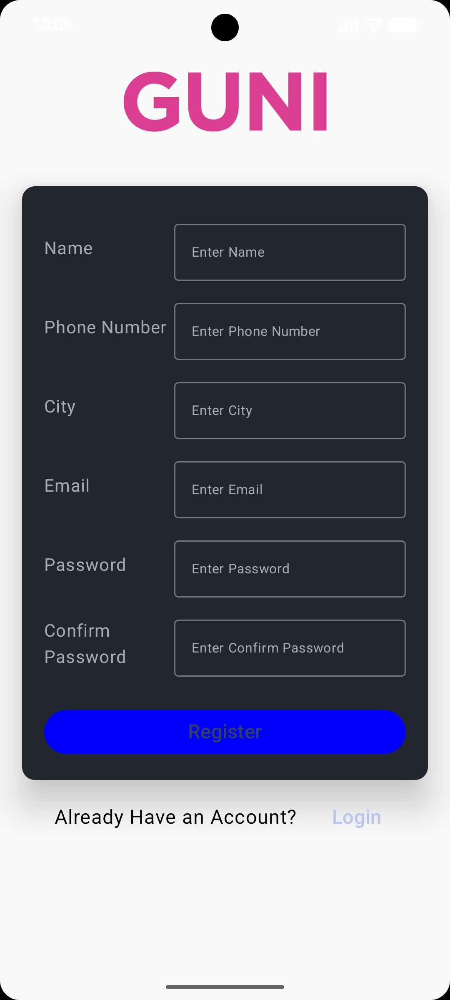

# Practical-5: Login and Registration using Jetpack Compose

## AIM & Objective

To develop an Android application that demonstrates **Login and Registration screens using Jetpack Compose**. The application provides a user-friendly interface where existing users can enter their login credentials and new users can register by providing the required details. The main objective is to understand UI design, composable functions, user input handling, button click events, and navigation between screens in Android development.

---

## Concepts & Components Used

* **Kotlin:** Programming language used to develop the Android application.
* **Android Studio:** IDE used to develop, run, and test the application.
* **Jetpack Compose:** Modern Android UI toolkit used to build the user interface.
* **Composable Functions:** Used to create reusable UI components for Login and Registration screens.
* **Login Screen:** Provides input fields for entering email or username and password.
* **Registration Screen:** Allows new users to enter the required personal and account details.
* **TextField:** Used to accept user input such as name, email, and password.
* **Password Input:** Used to enter password information securely in the user interface.
* **Button:** Used to perform actions such as Login, Register, and switching between screens.
* **Click Events:** Handle user interactions when buttons or clickable text elements are selected.
* **Navigation Between Screens:** Allows users to move between the Login and Registration screens.
* **Column and Row Layouts:** Used to arrange UI components vertically and horizontally.
* **Material Design Components:** Provide a clean and consistent interface.
* **State Management:** Helps manage and update UI values when users enter information.
* **UI Design and Interaction:** Demonstrates the creation of an interactive and user-friendly Android application.

---

## 📱 Output

### 🖼️ Screenshots

#### Login Screen

<table>
  <tr>
    <td align="center">
      
      <br><br>
      <b>1. Login Screen</b>
    </td>
  </tr>
</table>

#### Registration Screen

<table>
  <tr>
    <td align="center">
      
      <br><br>
      <b>2. Registration Screen</b>
    </td>
  </tr>
</table>

---

## Application Working

1. The application starts by displaying the Login screen.
2. The Login screen provides input fields for entering the user's email or username and password.
3. The user enters the required login credentials using the provided text fields.
4. The Login button allows the user to interact with the login interface.
5. New users can select the Registration option to navigate to the Registration screen.
6. The Registration screen displays the required fields for entering user information.
7. The user fills in the registration details using the available text fields.
8. The Register button allows the user to interact with the registration interface.
9. Users can navigate between the Login and Registration screens using the available buttons or clickable text.
10. Jetpack Compose updates the user interface based on user interactions and the application's state.

---

## Technologies Used

* **Kotlin**
* **Android Studio**
* **Android SDK**
* **Jetpack Compose**
* **Material Design Components**
* **Composable Functions**
* **Android UI Components**

---

## Student Details

* **Enrollment No:** 24012011143
* **Practical:** 05
* **Subject:** Mobile Application Development (MAD)

---

## Project Structure

```text
Practical-5/
│
├── app/
│   ├── src/
│   │   └── main/
│   │       ├── java/
│   │       │   └── .../
│   │       │       └── MainActivity.kt
│   │       ├── res/
│   │       │   └── ...
│   │       └── AndroidManifest.xml
│   │
│   ├── screenshots/
│   │   ├── ss1.png
│   │   └── ss2.png
│   │
│   └── build.gradle.kts
│
├── README.md
│
└── ...
```

---

## Conclusion

Successfully implemented an Android application containing **Login and Registration screens using Jetpack Compose**. This practical demonstrates the use of composable functions, text fields, buttons, layouts, state management, and user interaction. It also provides an understanding of navigation between screens and the development of a simple, interactive, and user-friendly Android application interface.
